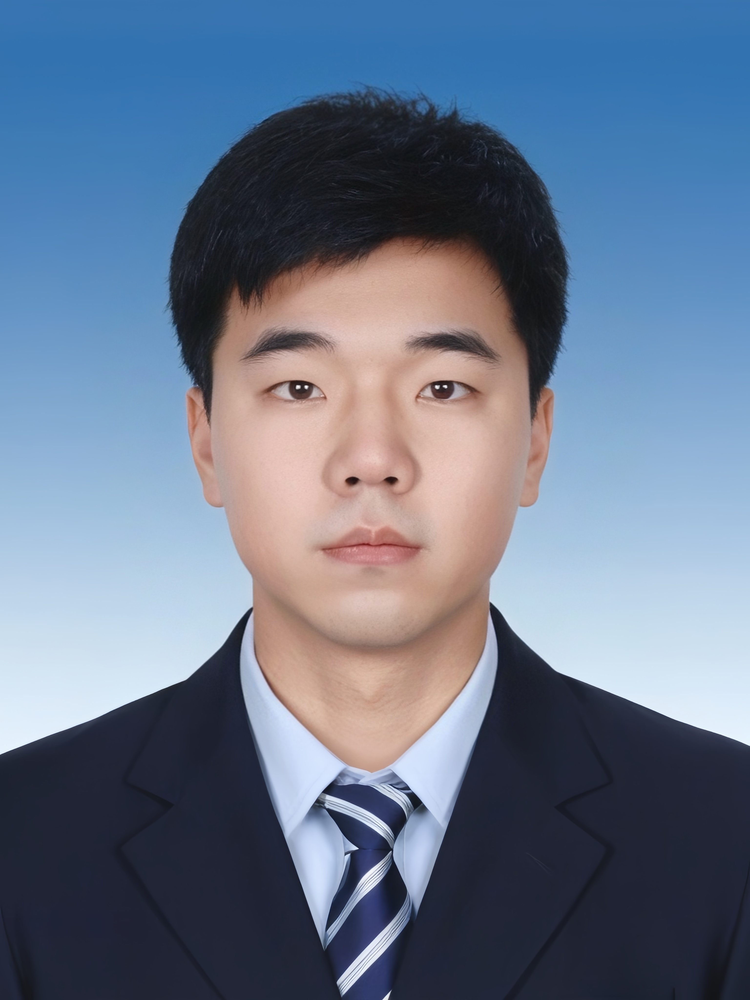

  
  <h1>Shuai Hao | Sergio Termann</h1>
  
<strong>Algorithm Engineer · LLM Agent Post-training · Multimodal RL · Multi-Agent RL</strong>

  
PhD Candidate, Beihang University · Former AI Team Lead

  

    <a href="mailto:by2203054@buaa.edu.cn">Email</a> ·
    Beijing, China ·
    <a href="https://sergiotermann.github.io/SergioTermann/">Homepage</a> ·
    <a href="https://github.com/SergioTermann?tab=repositories">Repositories</a> ·
    <a href="./README_ZH.md">中文</a> · <a href="./README_DE.md">Deutsch</a>
  

## Profile

I build learning agents end to end: problem definition, data construction, post-training, offline evaluation, online inference, and metric feedback. My current work focuses on **Agentic RL post-training, process value models for coding agents, multimodal RL, multi-agent reinforcement learning, and production inference systems**.

I am a PhD candidate at Beihang University. Previously, I led AI architecture, data, training, deployment, and delivery for a production intelligent-operations Agent. I am seeking an **LLM agent post-training algorithm internship in Beijing**, available five days per week for six months.

## Selected results

| Result | Evidence |
| --- | --- |
| Production Agent | Ticket closure +12.4%; first-fix success +8.7%; self-service diagnosis closure +18.5% |
| Coding Agent PVM | Best-of-N selection 0.926±0.049 vs. verifier oracle 0.931; no extra test execution |
| Inference efficiency | Early abandonment saves ~15% end-to-end compute with near-zero accuracy loss |
| Multimodal RL | Geo-RL SVS 2.20→3.55 (+61%) vs. LLaVA-1.5 7B MLE |
| UAV air combat | Kill rate 2.3× SOTA; engagement time −30% |

## Technical focus

- **LLM post-training:** RLVR / GRPO, SFT, LoRA, reward engineering, PRM / PVM, Best-of-N, rejection sampling
- **Agent systems:** Planner–Executor, hybrid RAG, Function Calling, failure-case recycling, SWE-bench-Lite evaluation
- **Reinforcement learning:** PPO, SAC, GAIL, multi-agent RL, set-level RL, Ray / RLlib, Isaac Sim / Isaac Lab
- **Inference and infrastructure:** vLLM, tensor parallelism, GPU clusters, TRL
- **Other:** SolidWorks, Blender, CAD, 3D printing, indoor/outdoor quadrotor swarm control

## Selected work

### Geo-RL for Long-Form Image Captioning · 2025 – 2026

**ICML 2026 · First student author**

- Contributed to problem formulation, geometric diversity reward design, credit assignment, implementation, evaluation, and ablations for *Escaping the Likelihood Trap: Geometric Diversity Optimization for Long-Form Image Captioning*.
- Combined a CLIP-weighted RBF-DPP log-determinant reward with pairwise repulsion, image–text alignment, hallucination penalties, and a KL trust region; PPO balances semantic coverage with visual fidelity.
- On DeCapBench, relative to LLaVA-1.5 7B MLE: Distinct-2 0.66→0.84, Semantic Volume Score 2.20→3.55, CLIPScore 0.74→0.81, and CHAIRi 8.3%→7.1%.

### Outcome-Supervised Prefix Value Model · 2026 – Present

**TNNLS under review · First author · Independently completed**

- Proposed a Prefix Value Model that learns success probabilities from terminal outcomes over observable process states, enabling Best-of-N selection, inference-time early abandonment, and outcome-predictability analysis for long-horizon coding agents.
- In information-budget-matched experiments, selection reached **0.926±0.049**, close to a verifier oracle of 0.931 and above majority voting 0.826 and trajectory-level PRM 0.901, with no extra test execution.
- Early abandonment saves about **15% end-to-end inference compute** with near-zero accuracy loss; outcome AUC rises from 0.73 to 0.95.
- Built vLLM trajectory collection and tensor-parallel inference for controllable 72B evaluation on dual 48GB GPUs. LoRA rejection-sampling fine-tuning improved single-pass repair success from 0.375 to 0.800.

### Intelligent-operations Agent · Beijing Fengqi Shiyu Technology · Sep 2024 – Oct 2026

**Former Partner / AI Team Lead / Project Owner**

- Led the Agent architecture, data, training, deployment, and delivery from zero to production: Planner–Executor, hybrid RAG, Function Calling, and automatic failure-case feedback.
- Trained Qwen3-8B with LoRA using TRL `GRPOTrainer` and vLLM; designed field-level rewards, Chinese–English equivalence checks, data quality gates, DAPO sampling, and an SFT→GRPO curriculum.
- Reduced training data from 9,215 to 2,310 high-value examples; slot extraction improved from 0.914 to 0.961 (+4.7 points).
- Online impact: ticket closure +12.4%, first-fix success +8.7%, self-service diagnosis closure +18.5%; tool hallucination 6.8%→2.9%; TTFT P50 860ms→810ms. The project received angel investment from Tsinghua Lihe.
- Shortened iteration time from 1–2 days to under half a day by separating volatile knowledge from model weights and structuring the training loop.

### Human-Guided Autonomous UAV Air Combat · Jan 2024 – Mar 2025

**Aerospace Science and Industry Intelligent Research Institute · Algorithm Intern · IEEE SMC Magazine first author, accepted**

- Built a Harfang 3D + Dogfight2 human–machine combat platform from scratch, including aerodynamics/collision solving, Gym wrappers, PyQt5 tooling, and PPO/SAC monitoring for 1v1–25v25 scenarios.
- Collected 2.7 hours of expert demonstrations (~100k timesteps), used GAIL for cold-start imitation and PPO for reward fine-tuning, improving kill rate 2.3× over SOTA and reducing engagement time 30%.
- Built Isaac Lab attack–defense scenarios, vectorized environments, a Blender→USD asset pipeline, ACMI 2.2 telemetry bridging, and Tacview replay.

### Multi-Agent RL Training Infrastructure · Mar 2020 – Mar 2022

**Institute of Automation, Chinese Academy of Sciences · Zhao Dongbin Group · Algorithm Intern**

- Designed QIARL with Q-irrelevance state abstraction and validated it across Procgen environments in PyTorch and TensorFlow.
- Built a learner–actor sampling system with ZeroMQ, multiprocessing, and shared memory, then migrated it to Ray / RLlib; parallel sampling throughput increased by an order of magnitude.
- Reproduced and adapted SMAC, PyMARL / PyMARL2, RLlib×SC2, and MADDPG×MPE baselines.

## Publications

- **First author · accepted** — IEEE Systems, Man, and Cybernetics Magazine (2026), *Human-Guided Autonomous Learning for UAV Air Combat Decision Optimization*
- **First author · under review** — TNNLS, *Outcome-Supervised Prefix Value Models for Best-of-N Selection and Early Abandonment in Long-Horizon Coding Agents*
- **First student author** — ICML 2026, *Escaping the Likelihood Trap: Geometric Diversity Optimization for Long-Form Image Captioning*
- **First author** — ICICIP 2021, *Learning Representation with Q-irrelevance Abstraction for Reinforcement Learning*
- **Co-author** — IEEE Transactions on Cognitive and Developmental Systems (2023), SCQRL; additional work in Aerospace Science and Technology and Guidance, Navigation and Control

## Competitions & honors

- **NeurIPS 2020 AIcrowd Procgen Challenge:** 7th of 82 teams in Round 1 and first among universities; led Ray / RLlib trainer changes, data augmentation, and search across 12 environments.
- **2023 Air Force “Unmanned Swarm” Challenge, 2v2 simulation:** Excellence Award, first among non-military universities.

## Beyond research

Beihang table tennis team member · Beijing rating 1650 · German A1

## Education

- **Beihang University**, School of Automation Science and Electrical Engineering — PhD Candidate, Sep 2022 – Present
- **Beihang University**, School of Software — MEng, Sep 2019 – Dec 2021; Outstanding Graduate of Beijing and Outstanding Graduate Student of Beihang University
- **Beijing Institute of Technology**, School of Optics and Photonics — BEng, Sep 2014 – Jun 2018; Outstanding Undergraduate Thesis and three university first prizes in science and technology competitions

  Focused on LLM agents, RL post-training, process value modeling, multimodal RL, and production inference systems.

