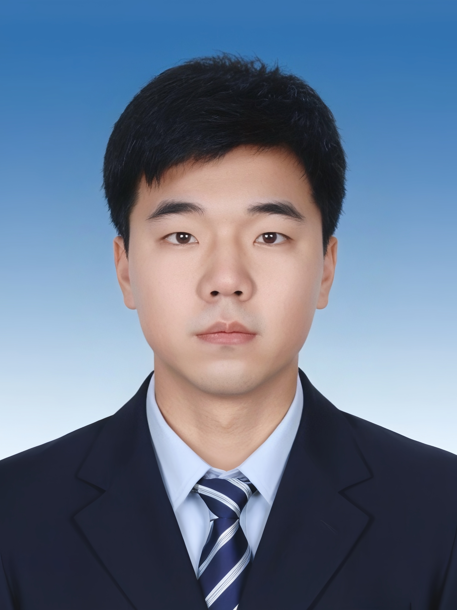

  
  <h1>Shuai Hao · Sergio Termann</h1>
  
<strong>PhD Candidate at Beihang University · LLM Agent Post-Training and Multimodal Reinforcement Learning</strong>

  

    <a href="mailto:by2203054@buaa.edu.cn">Email</a> ·
    <a href="https://github.com/SergioTermann?tab=repositories">Repositories</a> ·
    <a href="https://sergiotermann.github.io/SergioTermann/">Personal Website</a> ·
    <a href="./README_DE.md" hreflang="de">German Version</a>
  

I study prefix value models for long-horizon coding agents and set-level reinforcement learning for vision–language models. Previously, I was a partner and AI team lead at Beijing Fengqi Shiyu Technology, where I led the architecture, training, and deployment of a production IT operations agent.

I am seeking an LLM agent post-training internship in Beijing and can work five days per week for six months.

## Selected Work

### Geo-RL for Long-Form Image Captioning

**ICML 2026 · First student author**

I contributed to method design, reward modeling, and evaluation. Geo-RL uses a CLIP-weighted determinantal point process to measure semantic coverage across captions and assigns credit to individual captions through leave-one-out marginal rewards. On DeCapBench, compared with LLaVA-1.5 7B MLE, the Semantic Volume Score rose from **2.20 to 3.55**, Distinct-2 increased from 0.66 to 0.84, and the object hallucination rate fell from 8.3% to 7.1%.

### Prefix Value Models for Long-Horizon Coding Agents

**IEEE TNNLS · First author · Under review**

I independently developed a prefix value model that learns from final task outcomes to predict success before a coding agent finishes. In experiments with matched information budgets, Best-of-N selection reached **0.926 ± 0.049**, close to the verifier oracle's 0.931, without running additional tests. Early stopping saved about **15% of end-to-end inference compute** with near-zero accuracy loss. I built the trajectory collection and tensor-parallel evaluation pipeline in vLLM for Qwen2.5-Coder models from 7B to 72B and evaluated them on SWE-bench-Lite.

### Production IT Operations Agent

**Beijing Fengqi Shiyu Technology · Former AI Team Lead · Sep 2024–Oct 2026**

I led the Planner–Executor architecture, hybrid retrieval, tool calling, and feedback from failed cases. I used TRL and vLLM to post-train Qwen3-8B with LoRA and GRPO. Field-level rewards and sample filtering raised the slot extraction score from 0.914 to 0.961. In production, **ticket closure improved by 12.4%**, and the tool hallucination rate fell from 6.8% to 2.9%.

## Publications and Research Experience

- **ICML 2026 · First student author** — *Escaping the Likelihood Trap: Geometric Diversity Optimization for Long-Form Image Captioning*
- **IEEE TNNLS · First author, under review** — *Outcome-Supervised Prefix Value Models for Best-of-N Selection and Early Abandonment in Long-Horizon Coding Agents*
- **IEEE SMC Magazine · First author, accepted** — *Human-Guided Autonomous Learning for UAV Air Combat Decision Optimization*
- **ICICIP 2021 · First author** — *Learning Representation with Q-irrelevance Abstraction for Reinforcement Learning*
- **IEEE TCDS 2023 · Co-author** — SCQRL, an extension of QIARL

At the Institute of Automation, Chinese Academy of Sciences, I studied state abstraction and ported a distributed learner–actor sampling system to Ray and RLlib. Our team placed **7th out of 82 in the first round** of the NeurIPS 2020 AIcrowd Procgen Challenge, the highest rank among university teams.

## Education

- **Beihang University** · PhD candidate, School of Automation Science and Electrical Engineering · Sep 2022–present
- **Beihang University** · Master's degree, School of Software · Sep 2019–Dec 2021 · Outstanding Graduate of Beijing
- **Beijing Institute of Technology** · Bachelor's degree, School of Optics and Photonics · Sep 2014–Jun 2018 · Outstanding undergraduate thesis

I play for the Beihang University table tennis team and have a Beijing rating of 1650.
