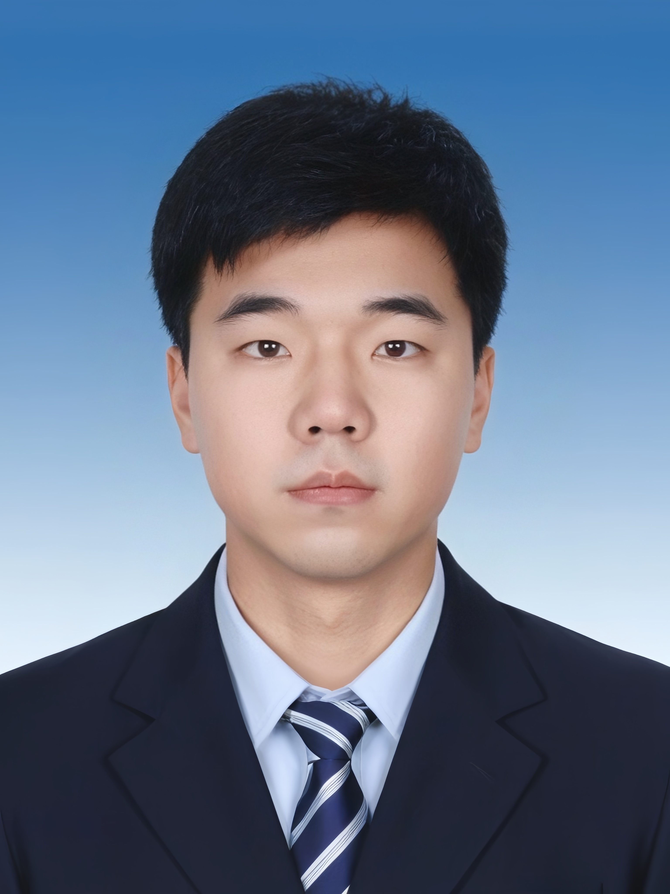

  
  <h1>Shuai Hao | Sergio Termann</h1>
  
<strong>LLM-Agenten · Multimodales Post-Training · Multi-Agenten-RL</strong>

  
Doktorand an der Beihang-Universität · Ehemaliger AI Team Lead

  
<a href="mailto:by2203054@buaa.edu.cn">E-Mail</a> · Peking · <a href="https://sergiotermann.github.io/SergioTermann/">Homepage</a> · <a href="./README.md">English</a> · <a href="./README_ZH.md">中文</a>

## Profil

Ich entwickle Lernverfahren und Agentensysteme von der Datenaufbereitung über Reward-Design und Post-Training bis zur Evaluation und Bereitstellung. Meine Schwerpunkte sind multimodales Reinforcement Learning, Wertmodelle für Coding-Agenten und produktive Agentensysteme.

Ich suche ein Praktikum im Bereich LLM-Agenten-Post-Training in Peking: fünf Tage pro Woche für sechs Monate.

## Ausgewählte Arbeiten

### Geo-RL · ICML 2026 · 2025–2026

**Erster studentischer Autor** — *Escaping the Likelihood Trap: Geometric Diversity Optimization for Long-Form Image Captioning*

- Mitarbeit an Modellierung, Reward-Design und experimenteller Validierung; mengenbasierte Rewards und PPO verbinden semantische Vielfalt mit visueller Genauigkeit.
- DeCapBench gegenüber LLaVA-1.5 7B MLE: Distinct-2 0.66→0.84, SVS 2.20→3.55, CLIPScore 0.74→0.81, Objekthalluzinationsrate 8.3%→7.1%.

### Prefix Value Model · 2026–heute

**TNNLS im Begutachtungsverfahren · Eigenständig durchgeführt**

- Algorithmus, Daten, Experimentalsystem und Manuskript eigenständig entwickelt. Endergebnisse dienen als Supervision für Erfolgsprognosen während langer Coding-Agent-Trajektorien.
- Best-of-N-Auswahl: 0.926±0.049 gegenüber Verifier-Oracle 0.931, ohne zusätzliche Testausführungen. Früher Abbruch spart ungefähr 15% Rechenaufwand bei nahezu unveränderter Genauigkeit.
- vLLM-Evaluation von Qwen2.5-Coder 7B–72B; LoRA-Fine-Tuning mit Rejection Sampling steigert die Erfolgsrate einzelner Reparaturversuche von 0.375 auf 0.800.

### Beijing Fengqi Shiyu Technology · Sept. 2024–Okt. 2026

**Ehemaliger Partner / AI Team Lead**

- Verantwortung für Architektur, Daten, Training und Bereitstellung eines Agenten für intelligenten IT-Betrieb: Planner–Executor, hybrides RAG und Function Calling.
- Qwen3-8B mit TRL GRPOTrainer, LoRA und vLLM; Trainingsdaten 9215→2310, Slot-Extraktion 0.914→0.961.
- Ticket-Abschlussrate +12.4%, Erstbehebung +8.7%, selbstständige Diagnoseabschlüsse +18.5%; Tool-Halluzinationen 6.8%→2.9%. Angel-Investment von Tsinghua Lihe.

### Aerospace Science and Industry Intelligent Research Institute · Jan. 2024–März 2025

**Algorithmus-Praktikant**

- Harfang-DogFight-Trainingsplattform, 2.7 Stunden Expertendemonstrationen, GAIL und PPO; Abschussrate 2.3× gegenüber SOTA, Gefechtsdauer −30%.
- Parallele Isaac-Lab-Simulationen, ACMI-2.2-Telemetrie und Tacview-Wiedergabe. Erstautor einer angenommenen Arbeit im IEEE Systems, Man, and Cybernetics Magazine (2026).

### Institut für Automatisierung, Chinesische Akademie der Wissenschaften · März 2020–März 2022

**Gruppe Zhao Dongbin · Algorithmus-Praktikant**

- QIARL-Repräsentationslernen, PyTorch-/TensorFlow-Validierung und verteilte Learner–Actor-Infrastruktur mit Ray / RLlib; Sampling-Durchsatz um eine Größenordnung erhöht.
- QIARL: Erstautor, ICICIP 2021; SCQRL: Mitautor, IEEE TCDS 2023.

## Ausbildung und Auszeichnungen

- **Beihang-Universität:** Promotion, School of Automation Science and Electrical Engineering, Sept. 2022–heute.
- **Beihang-Universität:** Master, School of Software, Sept. 2019–Dez. 2021; Auszeichnung der Stadt Peking und der Universität.
- **Beijing Institute of Technology:** Bachelor, School of Optics and Photonics, Sept. 2014–Juni 2018; ausgezeichnete Abschlussarbeit und drei erste Preise bei universitären Wissenschafts- und Technologiewettbewerben.
- **NeurIPS 2020 AIcrowd Procgen Challenge:** Platz 7 von 82 Teams, erstes Hochschulteam.
- **Air Force Challenge 2023:** Excellence Award im 2v2-Simulationswettbewerb, erstes Team unter nichtmilitärischen Hochschulen.

## Weitere Fähigkeiten

SolidWorks, Blender, CAD, 3D-Druck und Quadrotor-Schwarmsteuerung. Mitglied des Beihang-Tischtennisteams (Peking-Rating 1650); Deutsch A1.
