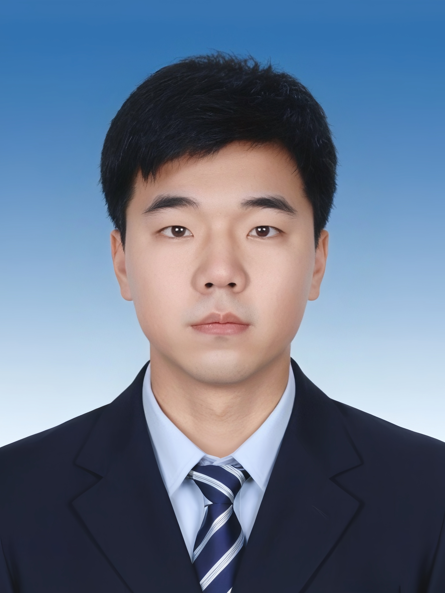

  
  <h1>Shuai Hao · Sergio Termann</h1>
  
<strong>Doktorand an der Beihang-Universität · Nachtraining von LLM-Agenten und multimodales verstärkendes Lernen</strong>

  

    <a href="mailto:by2203054@buaa.edu.cn">E-Mail</a> ·
    <a href="https://github.com/SergioTermann?tab=repositories">Quellcode</a> ·
    <a href="https://sergiotermann.github.io/SergioTermann/">Persönliche Website</a> ·
    <a href="https://github.com/SergioTermann?tab=overview" hreflang="en">Englische Fassung</a>
  

Ich erforsche Präfix-Wertmodelle für Programmieragenten, die Aufgaben über viele Schritte hinweg bearbeiten, sowie verstärkendes Lernen auf Mengenebene für Bild-Sprach-Modelle. Zuvor war ich Partner und KI-Teamleiter bei Beijing Fengqi Shiyu Technology. Dort leitete ich die Entwicklung, das Training und die Einführung eines Agenten für den IT-Betrieb.

Ich suche in Peking ein sechsmonatiges Praktikum im Nachtraining von LLM-Agenten und bin fünf Tage pro Woche verfügbar.

## Ausgewählte Arbeiten

### Geo-RL für ausführliche Bildbeschreibungen

**ICML 2026 · Erstautor unter den Studierenden**

Ich war an der Methodenentwicklung, der Gestaltung der Belohnungsfunktion und der Auswertung beteiligt. Geo-RL misst mit einem CLIP-gewichteten determinantalen Punktprozess, wie gut eine Menge von Beschreibungen den Bildinhalt abdeckt. Die Methode bewertet den Beitrag jeder Beschreibung, indem sie diese einzeln aus der Menge entfernt. Auf DeCapBench stieg gegenüber LLaVA-1.5 7B MLE das Maß für das semantische Volumen von **2,20 auf 3,55** und Distinct-2 von 0,66 auf 0,84. Der Anteil fälschlich genannter Objekte sank von 8,3 % auf 7,1 %.

### Präfix-Wertmodelle für mehrstufige Programmieraufgaben

**IEEE TNNLS · Erstautor · Im Begutachtungsverfahren**

Ich entwickelte eigenständig ein Präfix-Wertmodell, das anhand des endgültigen Aufgabenergebnisses lernt, den Erfolg eines Programmieragenten bereits während der Bearbeitung vorherzusagen. In Experimenten mit gleichem Informationsbudget erzielte die Auswahl des besten von N Kandidaten **0,926 ± 0,049**. Der Referenzwert des Verifikators lag bei 0,931. Für die Auswahl waren keine zusätzlichen Testläufe nötig. Ein frühzeitiger Abbruch sparte rund **15 % des gesamten Inferenzaufwands** bei nahezu unveränderter Genauigkeit. Mit vLLM richtete ich die Erfassung der Bearbeitungsverläufe und die tensorparallele Auswertung von Qwen2.5-Coder-Modellen mit 7 bis 72 Milliarden Parametern auf SWE-bench-Lite ein.

### Agent für den IT-Betrieb

**Beijing Fengqi Shiyu Technology · Ehemaliger KI-Teamleiter · Sep. 2024–Okt. 2026**

Ich leitete die Entwicklung der Architektur für Planung und Ausführung, der hybriden Suche, der Werkzeugaufrufe und der Rückführung fehlgeschlagener Fälle in den Trainingsprozess. Mit TRL und vLLM trainierte ich Qwen3-8B mit LoRA und GRPO nach. Feldbezogene Belohnungen und die Auswahl geeigneter Trainingsbeispiele steigerten den Messwert für die Feldextraktion von 0,914 auf 0,961. Im laufenden Betrieb stieg die **Abschlussquote der Tickets um 12,4 %**. Die Rate halluzinierter Werkzeugaufrufe sank von 6,8 % auf 2,9 %.

## Publikationen und Forschungserfahrung

- **ICML 2026 · Erstautor unter den Studierenden** — Geometrische Diversität für ausführliche Bildbeschreibungen
- **IEEE TNNLS · Erstautor, im Begutachtungsverfahren** — Präfix-Wertmodelle mit Erfolgssignalen für Auswahl und frühzeitigen Abbruch bei Programmieragenten
- **IEEE SMC Magazine · Erstautor, angenommen** — Durch menschliche Demonstrationen angeleitetes Lernen für Entscheidungen im simulierten Drohnenluftkampf
- **ICICIP 2021 · Erstautor** — Repräsentationslernen mit Q-Irrelevanz-Abstraktion für verstärkendes Lernen
- **IEEE TCDS 2023 · Mitautor** — SCQRL, eine Erweiterung von QIARL

Am Institut für Automatisierung der Chinesischen Akademie der Wissenschaften forschte ich zur Zustandsabstraktion und portierte ein verteiltes System zur Stichprobenerhebung auf Ray und RLlib. Bei der NeurIPS 2020 AIcrowd Procgen Challenge belegte unser Team in der ersten Runde **Platz 7 von 82** und war damit das bestplatzierte Hochschulteam.

## Ausbildung

- **Beihang-Universität** · Promotion in Arbeit, Fakultät für Automatisierung und Elektrotechnik · seit Sep. 2022
- **Beihang-Universität** · Master, Fakultät für Software · Sep. 2019–Dez. 2021 · Auszeichnung als herausragender Absolvent der Stadt Peking
- **Beijing Institute of Technology** · Bachelor, Fakultät für Optik und Photonik · Sep. 2014–Juni 2018 · Auszeichnung für die Bachelorarbeit

Ich spiele in der Tischtennismannschaft der Beihang-Universität und habe in Peking eine Wertungszahl von 1650.
