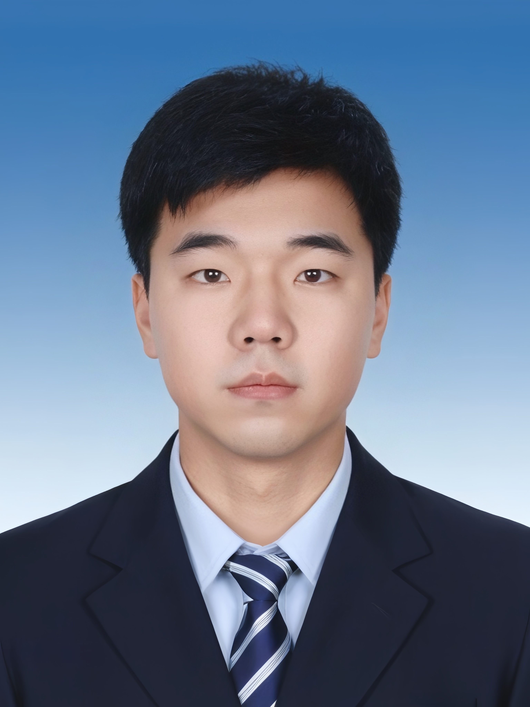

  
  <h1>郝帅 | Sergio Termann</h1>
  
<strong>算法工程师 · 大模型 Agent 后训练 · 多模态强化学习 · 多智能体强化学习</strong>

  
北京航空航天大学博士研究生 · 曾任 AI Team Lead

  

    <a href="mailto:by2203054@buaa.edu.cn">邮箱</a> · 中国北京 ·
    <a href="https://sergiotermann.github.io/SergioTermann/">个人主页</a> ·
    <a href="https://github.com/SergioTermann?tab=repositories">GitHub</a> ·
    <a href="./README.md">English</a> · <a href="./README_DE.md">Deutsch</a>
  

## 核心定位

我围绕“问题定义、数据构造、模型后训练、离线评测、在线推理、指标回流”闭环构建学习型 Agent。当前主线聚焦 **Agentic RL 后训练、Coding Agent 过程价值模型、多模态 RL、多智能体强化学习，以及生产级推理系统**。

我在北京航空航天大学攻读博士，曾在北京风起时域科技负责生产级智能运维 Agent 的架构、数据、训练、部署与交付。求职目标：**北京的大模型 Agent 后训练算法实习，每周 5 天、持续 6 个月**。

## 关键结果

| 结果 | 指标 |
| --- | --- |
| 生产 Agent | 工单闭环率 +12.4%；首修成功率 +8.7%；自助诊断闭环率 +18.5% |
| Coding Agent PVM | Best-of-N 选择性能 0.926±0.049，接近 verifier oracle 0.931；零额外测试执行开销 |
| 推理效率 | 早停节省约 15% 端到端算力，精度近零损失 |
| 多模态 RL | Geo-RL 语义体积 SVS 2.20→3.55（+61%） |
| 无人机空战 | 击杀率较 SOTA 提升 2.3 倍，交战耗时缩短 30% |

## 技术方向

- **大模型后训练：** RLVR / GRPO、SFT、LoRA、奖励设计、PRM / PVM、Best-of-N、拒绝采样微调
- **Agent 系统：** Planner–Executor、混合 RAG、Function Calling、失败样本回流、SWE-bench-Lite 评测
- **强化学习：** PPO、SAC、GAIL、多智能体 RL、集合级 RL、Ray / RLlib、Isaac Sim / Isaac Lab
- **推理与基础设施：** vLLM、张量并行、GPU 集群、TRL
- **其他：** SolidWorks、Blender、CAD、3D 打印、室内外四旋翼集群控制

## 代表工作

### Geo-RL 长文本图像描述 · 2025 – 2026

**ICML 2026 · 学生一作**

- 参与几何多样性奖励、信用分配、实现、评测与消融，缓解长文本图像描述的输出趋同与细节覆盖不足。
- 在 DeCapBench 上，相较 LLaVA-1.5 7B MLE：Distinct-2 0.66→0.84，SVS 2.20→3.55，CLIPScore 0.74→0.81，CHAIRi 8.3%→7.1%。

### 长链路 Coding Agent 的前缀价值模型 · 2026 – 至今

**TNNLS 在审 · 第一作者 · 独立完成**

- 仅以终局成败监督中间状态，学习可观测过程状态上的成功概率，支持 Best-of-N 选择、推理时早停与结局可预测性分析。
- 信息预算对齐实验中选择性能 **0.926±0.049**，接近 verifier oracle 0.931，高于多数投票 0.826 与轨迹级 PRM 0.901，零额外测试执行开销。
- 基于 PVM 阈值提前放弃低成功率 rollout，节省约 **15% 端到端推理算力**，精度近零损失；结局可预测性 AUC 由 0.73 提升至 0.95。
- 基于 vLLM 完成轨迹采集与张量并行推理，在双卡 48GB 环境评测 72B；LoRA 拒绝采样微调将单次修复成功率由 0.375 提升至 0.800。

### 智能运维 Agent · 北京风起时域科技 · 2024.09 – 2026.10

**曾任合伙人 / AI Team Lead / 项目 Owner**

- 从 0 到 1 统筹 Agent 架构、数据、训练、部署与交付：Planner–Executor、混合 RAG、Function Calling 与失败样本自动回流。
- 基于 TRL `GRPOTrainer` + vLLM 对 Qwen3-8B 进行 LoRA 训练，设计字段级奖励、中英等价判定、数据质量门禁、DAPO 动态采样与 SFT→GRPO 课程。
- 训练样本由 9215 条治理至 2310 条高价值数据；槽位提取指标 0.914→0.961（+4.7 个百分点）。
- 线上工单闭环率 +12.4%、首修成功率 +8.7%、自助诊断闭环率 +18.5%；工具幻觉率 6.8%→2.9%，TTFT P50 860ms→810ms。项目获清华力合天使轮投资。
- 通过知识与技能分层、结构化检索和训练流程治理，将迭代周期从 1–2 天压缩到半天以内。

### 人类经验引导的无人机空战决策 · 2024.01 – 2025.03

**航天科工集团智能研究院 · 算法实习生 · IEEE SMC Magazine 一作已录用**

- 从 0 到 1 搭建 Harfang 3D + Dogfight2 人机混合空战平台，完成气动/碰撞解算、Gym 封装、PyQt5 工具与 PPO/SAC 训练监控，覆盖 1v1 至 25v25。
- 采集 2.7 小时、约 10 万时间步专家演示，以 GAIL 冷启动、PPO 真实奖励微调，击杀率较 SOTA 提升 2.3 倍，交战耗时缩短 30%。
- 搭建 Isaac Lab 攻防想定、向量化环境、Blender→USD 资产管线、ACMI 2.2 遥测桥接与 Tacview 回放。

### 多智能体强化学习训练基础设施 · 2020.03 – 2022.03

**中国科学院自动化研究所 · 赵冬斌团队 · 算法实习生**

- 基于 Q-π 无关状态抽象设计 QIARL，在 Procgen 多环境、多设定下完成 PyTorch / TensorFlow 双框架验证。
- 自研 learner–actor 并行采样架构并迁移至 Ray / RLlib，并行采样吞吐较单机提升一个数量级。
- 复现并适配 SMAC、PyMARL / PyMARL2、RLlib×SC2 与 MADDPG×MPE 等训练评测底座。

## 论文与荣誉

- **一作·已录用：** IEEE Systems, Man, and Cybernetics Magazine（2026），*Human-Guided Autonomous Learning for UAV Air Combat Decision Optimization*
- **一作·在审：** TNNLS，*Outcome-Supervised Prefix Value Models for Best-of-N Selection and Early Abandonment in Long-Horizon Coding Agents*
- **学生一作：** ICML 2026，*Escaping the Likelihood Trap: Geometric Diversity Optimization for Long-Form Image Captioning*
- **一作：** ICICIP 2021，*Learning Representation with Q-irrelevance Abstraction for Reinforcement Learning*
- **其他论文：** IEEE Transactions on Cognitive and Developmental Systems（2023，SCQRL）、Aerospace Science and Technology、Guidance, Navigation and Control
- **竞赛：** NeurIPS 2020 AIcrowd Procgen 挑战赛第一轮 82 队第 7、高校第一；2023 空军“无人争锋”2V2 仿真赛优胜奖、非军事高校第一。

## 技能与特长补充

北航乒乓球校队成员，北京市 1650 积分；德语 A1。

## 教育背景

- **北京航空航天大学**，自动化科学与电气工程学院，博士研究生，2022.09 – 至今
- **北京航空航天大学**，软件学院，硕士，2019.09 – 2021.12；北京市优秀毕业生、北航优秀研究生
- **北京理工大学**，光电学院，本科，2014.09 – 2018.06；优秀毕业论文、校级科技竞赛一等奖三项（第一作者）

  关注大模型 Agent、RL 后训练、过程价值建模、多模态 RL 与生产级推理系统。

